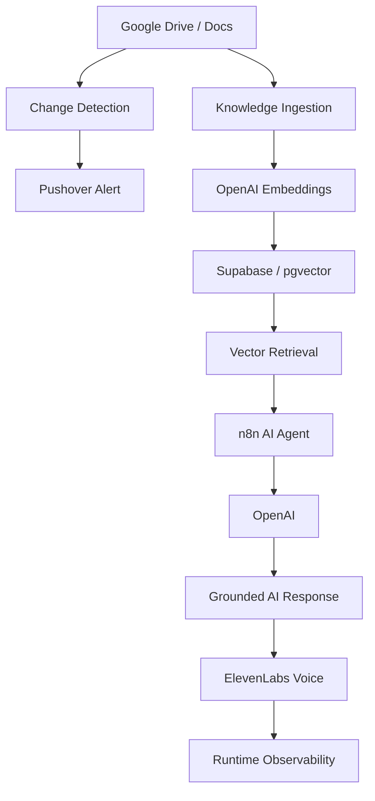

# Texas Beautiful Gardens

### Agentic RAG Knowledge & Voice Intelligence Platform

Texas Beautiful Gardens demonstrates how business knowledge can be transformed into a maintainable, grounded AI experience for customers and employees.

The system combines automated knowledge operations, vector retrieval, agentic reasoning, and conversational voice to answer domain-specific questions using the business's own information.

> **The goal wasn't to build another chatbot. It was to make business knowledge available when and where someone needs it.**

---

## The Business Problem

Garden centers and nurseries depend heavily on specialized employee knowledge.

Customers ask questions such as:

- What will survive full Texas sun?
- Which trees work well in the Austin area?
- What requires the least maintenance?
- How much water will this plant need?
- What would work near a patio?
- Which option best fits a particular landscape?

Experienced employees may know the answers immediately.

But that expertise doesn't always scale across locations, employees, shifts, or customer channels.

Texas Beautiful Gardens explores a different approach:

**Turn organizational knowledge into an intelligent system that can retrieve, reason over, and communicate that expertise consistently.**

---

## Solution Architecture

The architecture separates **knowledge management**, **retrieval**, **reasoning**, and **interaction** rather than treating RAG as a single monolithic workflow.

---

## 1. Automated Knowledge Operations

Google Drive acts as part of the business-facing knowledge workflow.

An n8n automation monitors the configured Drive source for file creation events and sends an operational notification through Pushover.

This provides a lightweight mechanism for detecting changes to the knowledge environment without requiring someone to continuously monitor the system.

### Why this matters

The people maintaining business knowledge should not need to understand vector databases, embeddings, or application code simply to manage source material.

Familiar business tools can remain part of the workflow while automation handles the surrounding operational tasks.

---

## 2. Agentic RAG

The question-answering layer is orchestrated through n8n.

A request enters through a webhook and is passed to an AI agent connected to:

- an OpenAI chat model
- a Supabase vector store
- OpenAI embeddings

Relevant business context can be retrieved from the vector store and supplied to the agent before it produces a response.

### Why RAG?

A general-purpose model may know a great deal about gardening.

It does **not** automatically know the organization's current products, recommendations, pricing, maintenance guidance, or business-specific knowledge.

Retrieval-Augmented Generation allows the system to ground responses in relevant information from the organization's own knowledge base rather than relying solely on the model's general knowledge.

---

## 3. Conversational Voice Experience

The intelligence layer is exposed through an ElevenLabs conversational agent: **Texas Beautiful Gardens Sales Expert**.

Instead of requiring customers or employees to interact with another traditional application interface, they can simply ask questions conversationally.

### 🎙️ Try the Live Voice Agent

[Launch Texas Beautiful Gardens Sales Expert](https://elevenlabs.io/app/talk-to?agent_id=agent_3901kz78watbfdjty39y71pswmf8&branch_id=agtbrch_6801kz78wcm8fh4b93ccbnwrf26y)

Try asking:

> "What tree would you recommend for full Texas sun?"

> "I need something low-maintenance for my backyard."

> "What would you recommend for the Austin area?"

**Demo availability:** Supporting services may be paused when not in active use to control infrastructure costs.

---

## 4. Observability & Evaluation

A conversational AI system shouldn't become a black box once deployed.

The ElevenLabs operational dashboard provides visibility into signals including:

- conversation success
- latency
- conversation cost
- duration
- topics
- sentiment
- customer satisfaction
- testing
- guardrail recommendations

During testing, the system identified conversations around:

> **Tree Recommendations for Specific Regions (e.g., Austin, Texas)**

This creates another feedback loop: the system can reveal not only whether customers are using it, but **what they're actually asking about**.

---

## Technology

| Layer | Technology |
|---|---|
| AI / Reasoning | OpenAI |
| Automation & Orchestration | n8n |
| Vector Retrieval | Supabase |
| Database | PostgreSQL / pgvector |
| Embeddings | OpenAI Embeddings |
| Voice Experience | ElevenLabs |
| Knowledge Workflow | Google Drive / Google Docs |
| Notifications | Pushover |
| Integration | Webhooks / REST APIs / JSON |

---

## Engineering Decisions

### Ground the model

Business-specific recommendations should come from business-specific knowledge.

The model provides reasoning and language capabilities; retrieval supplies relevant organizational context.

### Separate ingestion from inference

Updating knowledge and answering questions are different responsibilities.

Keeping those concerns separate makes the architecture easier to reason about, maintain, and evolve.

### Keep business users close to familiar tools

A knowledge system becomes less useful if every update requires an engineer.

Using familiar document workflows reduces the distance between the people who possess domain expertise and the system consuming it.

### Automate where automation creates value

Not every requirement needs another custom service.

The Google Drive → Pushover workflow solves the change-notification requirement without introducing unnecessary application code.

### Make the system observable

A successful response is only one signal.

Latency, cost, conversation topics, success rates, testing, and customer-experience indicators provide information needed to operate and improve the system.

---

## Business Value

The value isn't simply that AI can answer a gardening question.

The larger opportunity is making specialized organizational knowledge:

**Available** — when an expert isn't.

**Consistent** — across customer interactions.

**Accessible** — through natural conversation.

**Maintainable** — as business knowledge changes.

**Measurable** — through operational telemetry.

The same architectural pattern can be applied anywhere valuable organizational knowledge is difficult to distribute consistently.

---

## What I Learned

The most important lesson from this project was that **RAG is only one component of a useful knowledge system**.

The harder architectural questions are around it:

> Where does knowledge originate?

> Who maintains it?

> How does the system know something changed?

> How is knowledge transformed for retrieval?

> How does the agent find the right context?

> How does the user interact with the intelligence?

> How do we know whether the system is actually working?

Those questions shifted the project from:

**"How do I build a RAG application?"**

to:

**"How do I design a maintainable knowledge system around AI?"**

That distinction matters.

---

## Design Philosophy

> **AI is an engineering partner—not a substitute for engineering.**

AI accelerated parts of the implementation, but architecture, integration, grounding, automation, testing, operational decisions, and business outcomes remain engineering responsibilities.

---

## Status

**Working prototype**

The major integration paths have been built and tested across n8n, OpenAI, Supabase, Google Drive, Pushover, and ElevenLabs.

Supporting services may be paused when not actively demonstrating the system to avoid unnecessary infrastructure costs.
