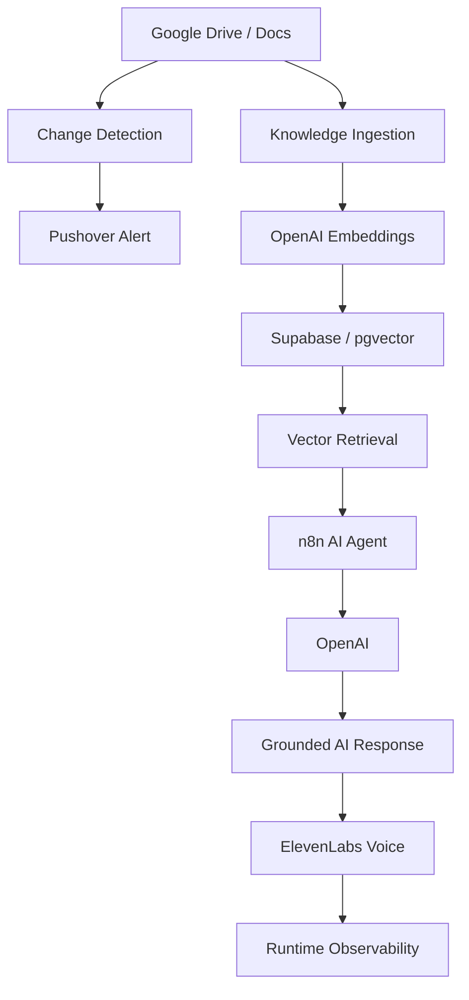

# Agentic RAG Knowledge & Voice Intelligence Platform

### Governed Knowledge Retrieval · Agentic Reasoning · Voice AI · Workflow Automation · Observability

A production-oriented AI architecture that transforms organizational knowledge into grounded, conversational intelligence.

The platform combines automated knowledge operations, vector retrieval, agentic reasoning, conversational voice, and runtime observability to make specialized organizational knowledge available through natural interaction.

> **The goal wasn't to build another chatbot. It was to design a maintainable intelligence system around organizational knowledge.**

---

## The Engineering Problem

Organizations possess enormous amounts of valuable domain knowledge.

The problem is rarely simply whether that information exists.

The harder questions are:

* Where does authoritative knowledge originate?
* Who maintains it?
* How does the system detect when knowledge changes?
* How is that knowledge prepared for retrieval?
* How does an AI agent determine which context is relevant?
* How do users interact with the resulting intelligence?
* How do operators know whether the system is actually working?

A useful enterprise AI system must address the lifecycle around retrieval—not merely connect an LLM to a vector database.

This project explores that larger architecture.

---

## Solution Architecture

The architecture deliberately separates **knowledge management, retrieval, reasoning, interaction, and operations** rather than treating RAG as one monolithic workflow.

---

## 1. Automated Knowledge Operations

Organizational knowledge changes.

A useful AI knowledge system therefore needs more than an initial ingestion pipeline—it needs an operational path for maintaining the information on which the intelligence depends.

Google Drive and Google Docs serve as business-facing knowledge sources.

An n8n automation monitors the configured knowledge environment for file events and triggers operational notifications through Pushover.

This creates a lightweight change-awareness mechanism without requiring someone to continuously monitor the underlying AI infrastructure.

### Engineering principle

> **The people who possess organizational knowledge should not need to understand embeddings, vector databases, or application code simply to maintain that knowledge.**

Familiar business tools remain part of the workflow while automation handles the surrounding technical operations.

---

## 2. Agentic RAG

The conversational intelligence layer is orchestrated through n8n.

Requests enter through a webhook and are passed into an AI workflow connected to:

* OpenAI reasoning
* OpenAI embeddings
* Supabase vector retrieval
* PostgreSQL / pgvector
* organizational knowledge sources

Relevant context is retrieved before generation so responses can be grounded in organizational information rather than relying exclusively on general model knowledge.

### Why retrieval matters

A general-purpose model may possess substantial domain knowledge.

It does not automatically possess an organization's current:

* products
* policies
* recommendations
* pricing
* operating procedures
* proprietary expertise
* changing business knowledge

Retrieval provides the context necessary to connect general reasoning capability with organizational truth.

> **Reasoning provides capability. Retrieval provides context. The surrounding architecture determines whether the combination becomes operationally useful.**

---

## 3. Conversational Voice Intelligence

The knowledge system is exposed through an ElevenLabs conversational voice agent.

Rather than requiring another dashboard or traditional application interface, users can interact with specialized organizational knowledge conversationally.

The voice layer turns the underlying retrieval and reasoning architecture into an accessible interface while keeping the knowledge and intelligence layers independently maintainable.

This separation matters.

The interface can evolve without redesigning the knowledge architecture, and the knowledge architecture can evolve without changing how users interact with the system.

---

## 4. Workflow Orchestration

n8n acts as the orchestration layer connecting knowledge sources, AI services, retrieval infrastructure, notifications, webhooks, and external interfaces.

This project deliberately distinguishes between:

**Deterministic automation** — operations that should follow defined workflows.

and

**AI reasoning** — operations where interpretation, language understanding, or contextual reasoning creates value.

Not every step needs an agent.

Not every workflow needs custom application code.

> **Use reasoning where reasoning is required. Use deterministic automation where the process can be explicitly defined.**

That distinction reduces unnecessary complexity while preserving AI capability where it provides meaningful value.

---

## 5. Observability & Evaluation

A conversational AI system should not become a black box after deployment.

Operational telemetry provides visibility into signals including:

* conversation success
* latency
* conversation cost
* duration
* conversation topics
* sentiment
* customer satisfaction
* testing
* guardrail recommendations

These signals create a feedback loop between system operation and system improvement.

The architecture therefore treats observability as part of the AI system rather than an afterthought.

> **A successful response is only one operational signal.**

A production-oriented AI system also needs evidence about cost, latency, usage patterns, failure modes, and the quality of the interaction itself.

---

## Technology Architecture

| Layer                          | Technology                  |
| ------------------------------ | --------------------------- |
| AI / Reasoning                 | OpenAI                      |
| Agent & Workflow Orchestration | n8n                         |
| Vector Retrieval               | Supabase                    |
| Vector Database                | PostgreSQL / pgvector       |
| Embeddings                     | OpenAI Embeddings           |
| Voice Intelligence             | ElevenLabs                  |
| Knowledge Operations           | Google Drive / Google Docs  |
| Operational Notifications      | Pushover                    |
| Integration                    | Webhooks / REST APIs / JSON |

---

## Engineering Decisions

### Ground organizational answers in organizational knowledge

Business-specific answers should come from business-specific evidence.

The model provides reasoning and language capabilities; retrieval supplies relevant organizational context.

### Separate ingestion from inference

Updating knowledge and answering questions are different responsibilities.

Keeping them separate makes the architecture easier to maintain, reason about, test, and evolve.

### Keep domain experts close to familiar tools

A knowledge system becomes less useful if every knowledge update requires an engineer.

The architecture minimizes the distance between the people who possess domain expertise and the systems consuming that expertise.

### Separate deterministic workflows from AI reasoning

Automation does not become better merely because an LLM is inserted into every step.

Defined operations remain deterministic where possible. AI is introduced where interpretation and reasoning justify the additional uncertainty and cost.

### Make the system observable

Production AI requires more evidence than whether an API returned `200 OK`.

Latency, cost, topics, conversation outcomes, testing, and customer-experience signals provide evidence necessary to operate and improve the system.

### Control infrastructure cost

Supporting services can be paused when they are not required for active demonstrations.

Cost is treated as an architectural constraint rather than something discovered after deployment.

---

## Reference Implementation: Texas Beautiful Gardens

The architecture was implemented against a Texas garden-center knowledge domain.

Garden centers and nurseries depend heavily on specialized employee knowledge.

Customers ask questions such as:

* What will survive full Texas sun?
* Which trees work well in this region?
* What requires the least maintenance?
* How much water will this plant need?
* What works near a patio?
* Which option best fits a particular landscape?

Experienced employees may answer these questions immediately.

That expertise, however, does not automatically scale across employees, shifts, locations, or customer channels.

The reference implementation explores how domain expertise can instead become **retrievable, maintainable, conversational organizational intelligence**.

The garden-center domain is the implementation.

**The reusable artifact is the architecture.**

---

## Business Value

The value of the system is not that an AI can answer a gardening question.

The larger opportunity is making specialized organizational knowledge:

**Available** — when an expert isn't.

**Consistent** — across interactions.

**Accessible** — through natural conversation.

**Maintainable** — as organizational knowledge changes.

**Observable** — through operational telemetry.

**Reusable** — across interfaces and workflows.

The same architectural pattern can be applied wherever valuable domain knowledge is difficult to distribute consistently.

---

## What This Project Demonstrates

This implementation demonstrates a broader transition from:

> **“How do I build a RAG application?”**

to:

> **“How do I design and operate a maintainable knowledge intelligence system around AI?”**

RAG is one component.

The engineering system surrounding it determines whether that capability can become useful in production.

---

## Design Philosophy

> **AI is an engineering partner—not a substitute for engineering.**

AI accelerated portions of implementation, but architecture, integration, grounding, workflow design, testing, operational decisions, observability, and business outcomes remain engineering responsibilities.

The objective is not maximum AI.

The objective is the appropriate combination of **reasoning, deterministic automation, organizational knowledge, operational controls, and human judgment**.

---

## Status

**Working prototype**

Major integration paths have been built and tested across n8n, OpenAI, Supabase, Google Drive, Pushover, and ElevenLabs.

Supporting services may be paused when not actively demonstrating the system to avoid unnecessary infrastructure costs.
